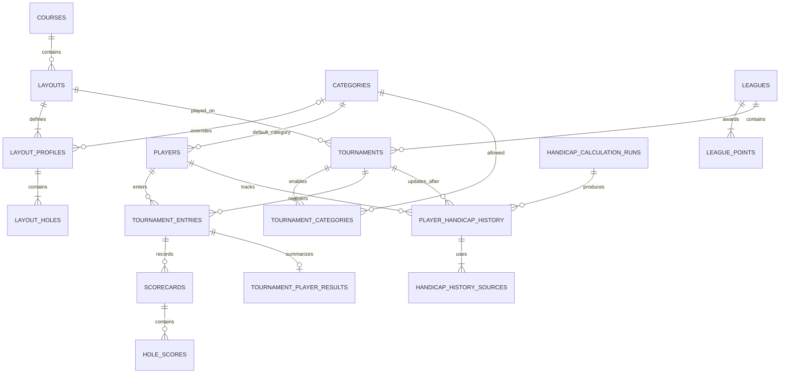

# Proposed relational model for SWAM Jahodna liga

Status: relational direction approved and local implementation prepared, 2026-10-14. Supabase SQL was installed by the user; the relational copy and local cutover are verified. Hosted deployment remains pending review. No commit authorized until user review. See RELATIONAL_MIGRATION.md for the runnable steps.

## Recommendation

Keep Supabase PostgreSQL and normalize the core entities. JSONB is useful for import metadata or an audit payload, but the entire application does not need to be one JSON value. Relationships, uniqueness, validation and hole statistics fit a relational database well. The current model remains usable at this scale, so migration is a maintainability improvement rather than an urgent performance fix. Switching to a document database would introduce another migration without simplifying these relationships.

The existing app can initially keep its domain dictionaries: a storage adapter assembles them from relational records. Writes should become transactional operations on affected entities, rather than replacing every record after every admin edit.

## Proposed tables

| Table | Important fields and purpose |
| --- | --- |
| categories | code primary key, display_order, archived_at; MPO/FPO/MA3 remain editable data. |
| players | existing id, first_name, last_name, udisc_username, default_category_code FK, current_handicap (latest calculated next handicap), current_handicap_snapshot_id FK, version, archived_at. Partial unique index on lower(trim(username)) for nonblank usernames. |
| courses | existing id, name, description, archived_at. Keep even though only Jahodna is currently used. |
| layouts | existing id, course_id FK, name, archived_at. Course → layouts is one-to-many. |
| layout_profiles | id, layout_id FK, category_code nullable FK; exactly one default profile per layout and at most one override per category. Partial unique indexes handle default/category uniqueness. |
| layout_holes | profile_id FK, hole_number, par integer, length_m numeric; primary key (profile_id, hole_number). Each profile has independent hole numbers/counts, preserving junior layouts. Keep zero lengths as unknown during migration. |
| leagues | existing id, name, points_scope, tie_mode, version, archived_at. |
| league_points | league_id FK, place integer, points integer; primary key (league_id, place). Placement rules remain live, as in the current app. |
| tournaments | existing id, league_id FK, layout_id FK, name, date DATE, num_rounds integer, version, archived_at. A tournament currently uses one layout; no layout junction needed. |
| tournament_categories | tournament_id FK, category_code FK; composite primary key. Enabled category list. |
| tournament_entries | tournament_id FK, player_id FK, category_code FK, handicap_used, handicap_snapshot_id FK; primary key (tournament_id, player_id). This is the players ↔ tournaments junction. Composite FK (tournament_id, category_code) references tournament_categories. |
| scorecards | existing round id, tournament_id, player_id, round_number, layout_id FK, category_snapshot, handicap_snapshot, total_throws integer, total_par integer, recorded_at, version. Composite FK to tournament_entries; unique (tournament_id, player_id, round_number). Current JSON rounds are player scorecards, not tournament-wide rounds. |
| hole_scores | scorecard_id FK, hole_number, throws integer, par_snapshot integer, length_snapshot numeric; primary key (scorecard_id, hole_number). Preserve every historical hole snapshot. No required FK to an editable current layout hole. |
| handicap_calculation_runs | id, algorithm_version, parameters, source_revision, calculated_at, status. Versioned audit record for initial backfill and later recalculations. |
| player_handicap_history | id, run_id FK, player_id FK, tournament_id FK, event_order, event_score, handicap_before, handicap_used, handicap_after, sample_count, bootstrap flag, calculated_at. Unique (run_id, player_id, tournament_id). Records the next handicap after each eligible completed tournament. |
| handicap_history_sources | snapshot_id FK, source_tournament_id FK, source_event_score, window_position; primary key (snapshot_id, source_tournament_id). Identifies the exact up-to-10 tournaments used in each calculation. |
| tournament_player_results | tournament_id/player_id composite FK to tournament_entries, stableford_points nullable integer, stableford_status, calculation_version, handicap_history_id FK. Stableford is per player and tournament; NULL means not yet calculated, never zero by default. |
| app_settings | singleton row with site_title and active_league_id FK. Preserve effective current defaults when legacy JSON omits settings; do not switch the visible active league during migration. |

Retain existing IDs as text initially to avoid needless identifier conversion. New profile IDs may use UUIDs. An application version field can be used for the transition lock and optimistic concurrency, then narrowed to per-entity versions for independent edits.

## Relationships

Junction tables are needed only for genuine many-to-many relationships. A league has many tournaments; a course has many layouts. Foreign keys handle those directly. League membership and league/layout usage can be derived from tournament participation; separate league_players or league_layouts tables would duplicate that information unless independent membership management is added later.

## Historical scores and statistics

- Current player category is a default; current handicap is derived from the latest active history snapshot. Tournament entries and scorecards retain the historical handicap used. Automatic retrospective backfill is a deliberate, audited change to previously recorded handicap fields; original imported values must remain recoverable. Category and original hole snapshots are not changed by handicap recalculation.
- Current layout profiles are templates. Each hole score retains its recorded par and length. Changing a layout cannot recalculate old results.
- Totals-only scorecards keep total throws and total par with no hole_scores rows. Do not invent hole data to populate the new tables.
- Public leaderboard points, ranks and heat maps remain derived. Handicap history is an explicitly persisted, versioned derived record for audit/reproducibility. Stableford may be materialized per tournament/player only with calculation version and dependency invalidation; do not persist unexplained leaderboard totals that can become stale.
- Calculate deviations and outcome percentages against each hole score's recorded par. Combine categories only within a specific layout, retaining current weighting. Par displays as an integer; averages and percentages display two decimals while calculations retain precision.
- Enforce positive pars/throws, valid round numbers, nonnegative lengths and placement points. Validate scorecard totals against hole sums in the transactional save function when hole data exists; totals-only cards are exempt from hole-sum validation. Enforce scorecard layout/category consistency with the event and registration in the save function or triggers.
- Prefer archive markers and restrictive foreign-key deletion rules for referenced entities. Do not introduce cascading deletion of historical scores.

## Handicap history and Stableford extension

This extends the accepted relational direction; the local implementation follows these rules. Production data has not been changed.

### Confirmed handicap timeline

For each player, process played tournaments in chronological event order, regardless of when their exports were imported. A tournament contributes once, not once per round. The handicap window is the latest 10 eligible tournaments, or all available tournaments when fewer than 10 exist. The score of the current tournament enters the calculation of the **next** handicap.

For tournament i with score S_i:

- The first recorded tournament is a special bootstrap: handicap_used_1 = S_1 and handicap_after_1 = S_1. Mark this row as bootstrap because its own result establishes its starting handicap.
- For each later tournament, handicap_used_i = handicap_after_(i−1).
- After the tournament, handicap_after_i = mean(S_j for j = max(1, i−9) through i).
- Copy handicap_after from the latest chronological snapshot to the player profile. Never use that current profile value when rendering an earlier tournament.
- Example scores +10, +14, +6 yield: event 1 uses 10 / next 10; event 2 uses 10 / next 12; event 3 uses 12 / next 10. At event 11, the next handicap excludes event 1 and averages events 2–11.

### Score definition and eligibility to finalize

Confirmed: S is relative to recorded par, not total throws. Handicaps are integers rounded toward positive infinity: 7.1 → 8 and −6.8 → −6. Keep unrounded event score inputs for averaging; do not repeatedly average already rounded prior handicaps.

Recommended additional conventions for review:

- Use tournaments across leagues/seasons, because the requested window is the player's last 10 tournaments rather than last 10 in a specific league. No seasonal reset.
- Only completed player results contribute: all required rounds for that player must be present. Registration, DNS and incomplete events do not produce a new handicap snapshot or consume a window slot. Totals-only completed results can contribute because total throws and recorded total par are available.
- For a multi-round tournament, use average relative-to-par per round as S, using relative-to-par, so the current per-round handicap convention remains meaningful. Otherwise a two-round event could disproportionately raise handicap. The local implementation uses this per-round normalization, consistent with the existing adjustment convention; the current backed-up data has no multi-round events.
- Do not invent a hole-count/course difficulty scaling formula. Differing pars are accounted for by relative-to-par; fewer played holes would still require an explicitly agreed normalization if comparisons demand it.
- For two tournaments on the same date, use explicit event start time/order. If unavailable, flag ambiguity for admin ordering rather than using import time or random IDs.
- No previous completed tournament means no profile handicap yet, rather than an assumed zero. For a debut player's live event, the bootstrap becomes known only once its first result is complete; the user-requested first-event historical handicap can then be filled retrospectively.

### Persistence and recalculation

History rows preserve both handicap_used at that event and handicap_after for the next one, plus the input score, sample count and source events. handicap_before is NULL for the bootstrap and otherwise the most recent prior handicap_after. Keep algorithm parameters/version and source revision in handicap_calculation_runs so every historical result can be explained.

A backdated import or score correction requires chronological recalculation for the affected player from that event forward. A changed score affects next handicaps while it remains in a later event's rolling window, and can also affect that later event's handicap-based result. Stage a new calculation run, validate it, then atomically activate its history, update tournament/scorecard handicap references, invalidate/recompute dependent Stableford results, and update the current player profile. Retain the previous calculation run for audit rather than deleting it. New registrations should derive handicap for their tournament date, even if the player's current profile already reflects later events.

Preserve original imported handicaps separately during migration/backfill (audit payload or immutable original value). Do not silently overwrite the only record of previous values. Original pars, throws, lengths and categories remain untouched. If a score/layout correction changes historical recorded pars, that must be a separate explicit action; editing the current layout template does not do so.

### Display requirements

- Tournament leaderboard/scorecards show the handicap **used for that tournament**, with adjusted score and Stableford once defined.
- Handicap history screen lists player, event/date, score, handicap used, handicap after/next, sample count (1–10), bootstrap status and an optional view of the window's source tournaments.
- Player profile shows latest next handicap and the event/date it was calculated after.
- Home and league aggregate standings should label the single displayed value **Current handicap**, because no single historical handicap applies to several tournaments. Tournament drill-down shows event-specific values. Do not sum or average handicaps across leaderboard rows without a separately requested rule.
- Include the applicable handicap in relevant leaderboard/player tables and exports. Hole-statistics tables do not have a player handicap. Retire the existing blanket suppression of Handicap/HCP adjusted columns when this feature is implemented, while retaining current ranking mode until a change is requested.

### Stableford

Store nullable Stableford results per tournament entry, calculated using that event's handicap_used, with a calculation version/status. Leave them uncalculated until the scoring rule is confirmed. No guessed formula will be used in the retrospective import.

Before calculating, agree on the points schedule, whether points apply per hole or to an event total, how a possibly fractional or negative handicap is applied, stroke allocation order if hole-based, and treatment of totals-only/incomplete scorecards. The current model does not store hole stroke indexes; add them to layout profiles and retain score-time snapshots only if the chosen formula needs them. Future points must be recalculated or marked pending after an upstream handicap/score change; zero is a valid score and must not represent missing data.

## Writes and access

Create explicit transactional operations for player updates, tournament creation, scorecard batches and imports. Supabase RPC database functions can perform related inserts/updates atomically. A single import must either save all its tournament/entry/score records or none. Keep optimistic concurrency so stale admin tabs cannot overwrite newer edits. During the initial compatibility phase, a global revision lock is acceptable; later use per-entity versions.

Keep the single-admin Streamlit login for the initial migration. Server-side credentials stay in secrets and never go to the browser. New exposed tables need explicit grants/RLS; anonymous database clients should have no write permissions. If using a server secret/service-role key, RLS does not replace application admin checks. Public queries/views should omit admin-only fields such as uDisc usernames. Supabase Auth for the administrator is an optional later improvement, not a prerequisite for changing the data model.

An optional import_batches table can record source filename/hash, timestamp, tournament and outcome for traceability. Do not make it the only duplicate protection: entity uniqueness and score comparisons are still needed. It is not required for the first migration.

## Additive migration and review plan

1. User reviews this proposal. Prepare SQL and a migration preview for review before executing it. Do not commit until the user has verified the work and explicitly authorizes committing.
2. Take a fresh export immediately before migration. The present backup covers app_data rows, not database roles, functions, grants or unrelated tables. Export schema/security definitions separately before changing them.
3. Create new tables alongside app_data in an isolated schema, without changing the running application's storage. Do not alter, overwrite, truncate or delete the existing JSON documents.
4. Copy the current data into the new tables in a transaction, preserving IDs, tournament links, categories, profiles and score snapshots. Perform this during a short admin-write pause or require a matching source revision; a staging copy alone is not sufficient if live edits continue.
5. Reconcile every entity and field, not just counts. Compare IDs, scorecard and hole totals, registrations, category overrides, effective settings, standings, tie points and statistics against the same source revision. Test imports, manual score entry, player edits and layout edits in an isolated preview app with disposable staging data.
6. After user verification, switch the app and command-line importers to the relational adapter. This includes auditing both league/storage.py and league/database.py so there is one authoritative write path. Initially preserve domain output structures to limit UI changes.
7. Leave app_data and the backups intact. Before normalized writes begin, switching back is straightforward. After normalized writes begin, rollback must first capture/reverse-export those new writes and verify the legacy-compatible document; simply switching to the old JSON would hide newer results. Test this rollback process before cutover. No cleanup/deletion is part of this proposal.

## Verified backup and baseline

Read-only export taken 2026-10-14 at 00:39 Europe/Bratislava:

- Backup: data/backups/supabase-app-data-before-schema-review-20261014-003911-361394.json
- SHA-256: 4dc4d5abf5f91bc1b11bb9b53dd18b96b099387a20982af52177ca3201a2ddd9
- One app_data document, main revision 50.
- 51 players, 3 leagues, 29 tournaments, 1 course, 2 layouts.
- 291 tournament entries, 291 scorecards, 5,238 hole scores.
- Export was reloaded and compared to its in-memory source. Backup permissions are owner-only and it is excluded from Git. SHA sidecar is stored beside it.

## References

- [Supabase PostgreSQL tables and foreign keys](https://supabase.com/docs/guides/database/tables)
- [Database functions and RPC](https://supabase.com/docs/guides/database/functions)
- [Row Level Security](https://supabase.com/docs/guides/database/postgres/row-level-security)
